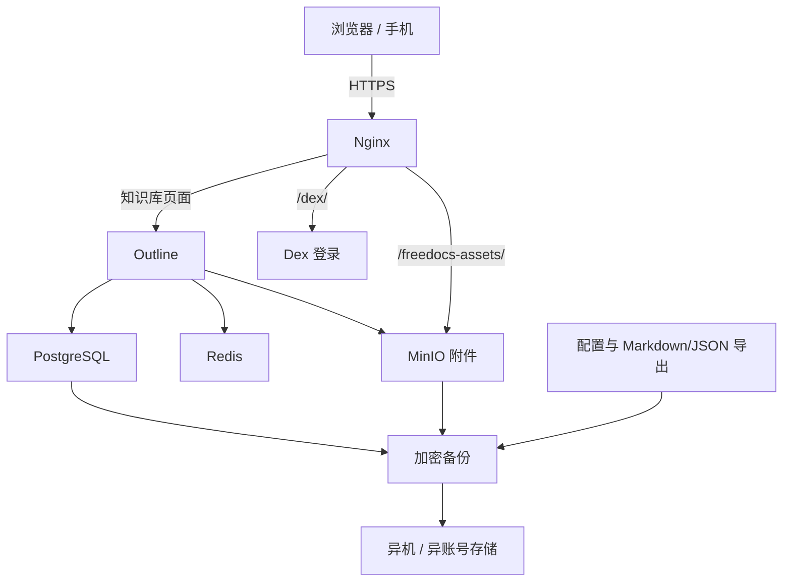

# FreeDocs

> 用一个 Skill，搭建、迁移并验收一套自己可控的飞书知识库平替。

FreeDocs 是一个面向 Codex 等 AI 编程 Agent 的开源 Skill。它会先审计你的服务器，再协助你部署 Outline、迁移 DOCX、配置分享与协作，并完成加密备份和恢复演练。

它的目标不是换一个“看起来能打开”的文档工具，而是把数据、备份和迁移能力真正掌握在自己手里。

## 为什么做 FreeDocs

我用了大约 5 年的飞书账号，后来账号突然因为“安全原因”被封。

那一刻我才发现：这些年积累的文档虽然每天都能看到，但我并没有真正掌握它们。一旦账号失去访问权限，工作资料、知识沉淀和长期记忆都会同时失去安全感。

这件事逼着我开始研究一个问题：

**能不能做一套平替版飞书知识库，既方便自己编辑，又能分享给别人看，还能协作和评论，同时把数据库、附件、备份与恢复能力留在自己手里？**

我最终选择了 Outline，并把 PostgreSQL、Redis、MinIO、Dex、Nginx 和迁移验收流程组合成一套可复用方案。第一次真实迁移中，39 个 DOCX 最终做到 39/39 可检索；发现的 3 组疑似重复文档全部保留，交给人判断，没有让自动化擅自删除。

FreeDocs 就是把这次搭建过程中真正有效的流程、踩过的坑和验收标准，封装成一个任何人都可以安装的 Skill。

## 它能帮你做什么

- 部署一套自托管的 Outline 知识库
- 使用 PostgreSQL 保存文档状态，MinIO 保存图片和附件
- 使用 Dex 提供基础登录，使用 Nginx 和 HTTPS 统一对外访问
- 从飞书或其他来源迁移 DOCX，并逐篇核验标题、正文、图片和搜索
- 设置成员编辑、登录后评论和公开只读分享
- 识别疑似重复文档，但不自动删除
- 创建加密备份，并在独立环境完成恢复演练
- 在每一步给出证据，不把“容器启动了”误报成“知识库完成了”

## 默认架构



服务器只向公网开放 80/443。Outline、Dex 和 MinIO 默认只绑定回环地址，PostgreSQL 与 Redis 不暴露主机端口。

## 安装

### 方法一：使用 Codex Skill Installer

```bash
python3 ~/.codex/skills/.system/skill-installer/scripts/install-skill-from-github.py \
  --url https://github.com/AIPMAndy/FreeDocs/tree/main/skills/freedocs
```

安装后，在新的 Codex 对话中调用：

```text
使用 $freedocs，先只读检查我的服务器和域名，然后帮我搭建一套自己可控的知识库。
原始导出文件绝对不能改动。任何公网、账号、权限或上传操作都先告诉我影响和回滚方法。
```

### 方法二：手动安装

```bash
git clone https://github.com/AIPMAndy/FreeDocs.git
mkdir -p ~/.codex/skills
cp -R FreeDocs/skills/freedocs ~/.codex/skills/freedocs
```

下一次对话即可使用 `$freedocs`。

## 小白应该怎样开始

准备好以下内容即可，其余步骤交给 Agent 逐项带你完成：

1. 一台你有管理权限的 Linux 服务器；
2. 一个可以修改 DNS 的域名或子域名；
3. 原始 DOCX 导出目录；
4. 一个不在主服务器、最好也不在同一云账号的备份位置；
5. 你希望实现的权限：仅自己、团队协作、公开只读分享，或三者并存。

FreeDocs 会根据现场选择三种模式之一：全新服务器、已有业务服务器，或修复已有 Outline。它不会为了套模板而替换你已经正常工作的代理、数据库或对象存储。

## 真正的完成标准

FreeDocs 不用一句含糊的“部署成功”结束任务，而是分六个状态验收：

| 状态 | 含义 |
|---|---|
| `INFRASTRUCTURE_READY` | 服务和路由健康，但还不代表能登录或导入 |
| `PRODUCT_READY` | 登录、编辑、搜索和一篇代表性 DOCX 已通过 |
| `MIGRATION_READY` | 所有获批源文件都有迁移台账和核验结果 |
| `SHARING_READY` | 成员权限与公开分享已用真实身份分别测试 |
| `RECOVERY_READY` | 加密备份已在新环境恢复并通过浏览器验收 |
| `COMPLETE` | 本次要求涉及的所有门禁均有证据通过 |

## 这套方案踩过的坑

- **服务健康不等于产品可用。** 容器全部 healthy，仍可能登录失败、上传失败或搜不到正文。
- **浏览器不能访问 Docker 内部地址。** 如果上传链接是 `http://minio:9000`，服务器自己能访问，用户浏览器却一定失败；附件必须通过公网 HTTPS 路由。
- **先迁移一篇，再批量。** 一篇带长正文、图片、表格和链接的 DOCX 可以提前暴露大多数链路问题。
- **同名不等于重复。** 自动删除可能毁掉不同版本或本来就要保留的文章，因此只标记、由人决定。
- **公开链接不等于内部文档地址。** 文档集、文档页面和公开分享链接是三种不同入口，要分别测试。
- **源码改对不等于用户看到的链接已更新。** 前端构建、缓存和移动端页面都要点击核验。
- **有备份文件不等于能恢复。** 只有在空环境恢复数据库、附件和配置，再检查搜索与权限，才算真正可恢复。

## 能力边界

- 自托管降低第三方平台账号被封导致的数据失控风险，但不代表“绝对安全”。你仍需负责服务器更新、密钥、访问控制、监控和异地备份。
- 默认公开分享是只读的；不要把匿名评论当作默认能力。团队评论需要登录并单独验收权限。
- FreeDocs 本身不包含 Outline 源码，只编排官方镜像和周边组件。
- Outline 当前采用 BSL 1.1/source-available 许可，并非 MIT 式宽松开源。个人或团队自托管前，以及向第三方提供商业托管服务前，请阅读并核对 Outline 的最新许可证。

## 仓库结构

```text
FreeDocs/
├── README.md
├── LICENSE
└── skills/
    └── freedocs/
        ├── SKILL.md
        ├── agents/openai.yaml
        ├── assets/freedocs-stack/
        ├── references/
        └── scripts/inventory_docx.py
```

## 安全原则

- 原始导出目录始终只读
- 不把密码、Token、Cookie 或生产 `.env` 提交到 Git
- 修改现有配置前先备份，并给出回滚路径
- DNS、防火墙、公网暴露、文档上传、权限调整和删除操作需要用户明确确认
- 不使用 `latest` 镜像标签
- 不在没有恢复证据时宣称数据已安全

## 许可证

FreeDocs 自身采用 [MIT License](LICENSE)。Outline 及其他组件分别遵循各自的许可证，MIT License 不会覆盖它们。

欢迎提交 Issue 或 Pull Request，把你遇到的部署、迁移和恢复问题变成下一位使用者不必再踩的坑。
